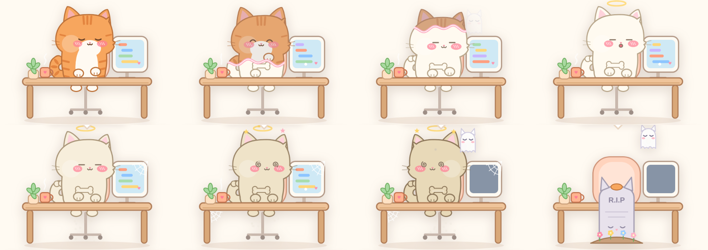
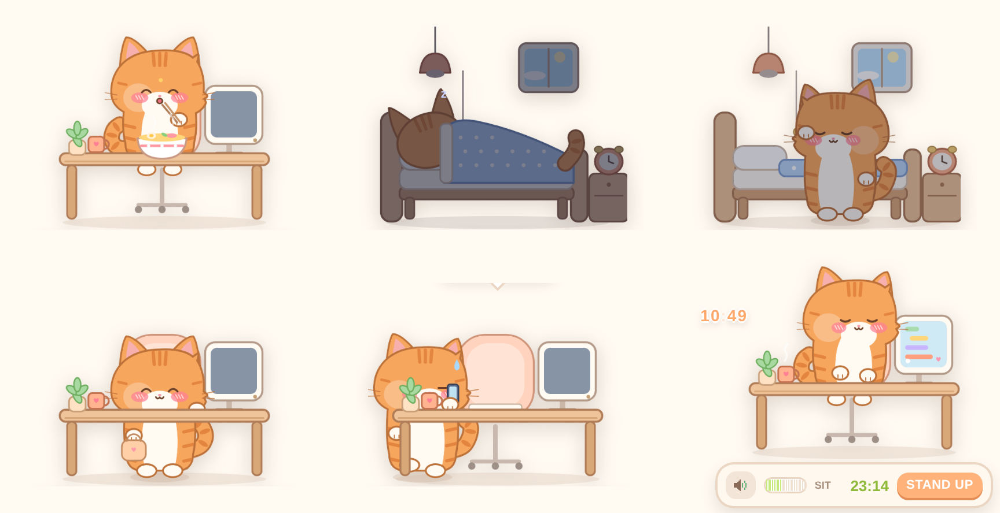

<h1>BoneUp 喵 🐾</h1>
<strong>九只小猫，陪你上班，也提醒你站起来。</strong>

1.3 特别版 · macOS / Windows · Mac 支持 Apple 芯片 / Intel

<a href="MEOW.md">English</a> | <strong>简体中文</strong>

 

BoneUp 喵是 BoneUp 的 Q 版猫咪特别版。坐太久，小猫逐渐变灰、塌下去，最后变成白白的骨头猫；站起来活动后点 **STAND UP**，帮助它恢复。

## 下载

[**下载 BoneUp 喵 1.3 Mac 版**](https://github.com/chartercharon26/BoneUp/releases/download/v1.3.0-meow/BoneUp-Meow-1.3-macOS.zip) · [**下载 Windows 版**](https://github.com/chartercharon26/BoneUp/releases/download/v1.3.0-meow/BoneUp-Meow-1.3-Windows.zip) · [发布说明](https://github.com/chartercharon26/BoneUp/releases/tag/v1.3.0-meow)

特别版提供 **Mac 与 Windows** 安装包。原版下载仍见[仓库首页](README.zh-CN.md#下载)。

## 坐久了，它会一点点变成骨头猫

## 特别版内容

- 9 只 Q 版小猫，各有外观和专属互动。
- 猫咪录音、音量控制和专注模式。
- 久坐变骨头猫、STAND UP 恢复及 WALK 倒计时。
- 上班、午饭、午休、下班场景，可调整作息和任务模式。
- 菜单和气泡支持简体中文／English。
- 程序、设置、开机启动项独立于原版 BoneUp。

## 安装与切换语言

### Mac

1. 完整解压 ZIP，打开 `BoneUp-Meow-1.3.dmg`。
2. 把 **BoneUp 喵** 拖入旁边的“应用程序”。
3. 从“应用程序”打开，菜单栏出现 **🐾**。
4. **🐾 → 语言 / Language** 可切换简体中文或 English。

首次启动会启用开机自动启动，并创建桌面／程序坞快捷方式，可在菜单中调整。程序采用本机签署，未经过 Apple 公证；如被 macOS 拦截，请在“系统设置 → 隐私与安全性”中检查。

### Windows 10 / 11

1. 下载 Windows ZIP，右键选择“全部解压”，不要在压缩包里直接运行。
2. 保留所有文件夹，双击 `install.bat`；它会调用本机 .NET Framework 编译器完成安装。
3. 安装后自动启动，也可从桌面或开始菜单打开 **BoneUp Meow**。
4. 右键系统托盘的猫咪图标，选择 **语言 / Language → 简体中文 / English**。

安装位置为 `%LOCALAPPDATA%\BoneUpMeow`。若找不到编译器，请安装微软 .NET Framework 4.8 后重试。Windows 包附中英文快速开始与中文 Windows 图文手册。

## 九只猫与小动作

在**工作或加班时、坐在桌前且尚未变成骨头猫**的状态下点击，触发下面的小动作；正在表演时不会被再次点击打断。骨头状态下点击只会动下巴。图片均来自 1.3 图文手册。

<table>
<tr>
<td width="50%" valign="top">
<strong>奶牛猫</strong>

低吼一声，伸爪挠屏幕，留下三道粉色爪印。
</td>
<td width="50%" valign="top">
<strong>灰白猫</strong>

用自己的猫叫唱小曲，头顶飘出音符。
</td>
</tr>
<tr>
<td width="50%" valign="top">
<strong>小白猫</strong>

害羞脸红，冒出爱心，轻声表达喜欢。
</td>
<td width="50%" valign="top">
<strong>奶油猫</strong>

缩成一条面包打盹，呼噜呼噜，然后醒来。
</td>
</tr>
<tr>
<td width="50%" valign="top">
<strong>橘猫（默认）</strong>

先盯着你，故意把桌上的杯子推下去摔碎，再得意地喵一声。
</td>
<td width="50%" valign="top">
<strong>灰狸花</strong>

双爪高举伸大懒腰，再打一个长长的哈欠。
</td>
</tr>
<tr>
<td width="50%" valign="top">
<strong>三花猫</strong>

发现毛线球后左扑右扑，兴奋地呼噜，忘记工作。
</td>
<td width="50%" valign="top">
<strong>小黑猫</strong>

关灯后响起诡异音效，黑暗中亮起双眼并突然哈气；再开灯呼噜，问你有没有被吓到。
</td>
</tr>
<tr>
<td colspan="2" align="center">
<strong>暹罗猫</strong>

超大声嚎一嗓子，出现声波，画面也跟着震动。
</td>
</tr>
</table>

切换：**🐾 → 悬浮小猫 → 换皮肤**。点 SIT 后的时间调整 1–60 分钟的久坐间隔；喇叭按钮调音量和专注模式。作息与任务模式仍在菜单中。

## 陪你过一天

## 图文使用说明

Mac 包含中英文图文说明；Windows 包含中文 Windows 图文手册与中英文快速开始。下面的单独图文指南以 Mac 安装为例，猫咪动作图适用于两版：

- [简体中文图文手册（PDF）](https://github.com/chartercharon26/BoneUp/releases/download/v1.3.0-meow/BoneUp-Meow-1.3-User-Guide-zh-CN.pdf)
- [English illustrated guide（HTML，下载后用浏览器打开）](https://github.com/chartercharon26/BoneUp/releases/download/v1.3.0-meow/BoneUp-Meow-1.3-User-Guide-English.html)

## 使用与反馈

[中文使用条款](MEOW-TERMS.zh-CN.txt)／[English terms](MEOW-TERMS.txt)，保留所有权利。本仓库提供安装包和说明，不授予开源许可。GitHub 自动生成的 **Source code** ZIP／TAR 不是程序安装包。

欢迎[用中文或英文提交问题](https://github.com/chartercharon26/BoneUp/issues)，请注明 **BoneUp 喵 1.3**、操作系统版本和实际情况。
