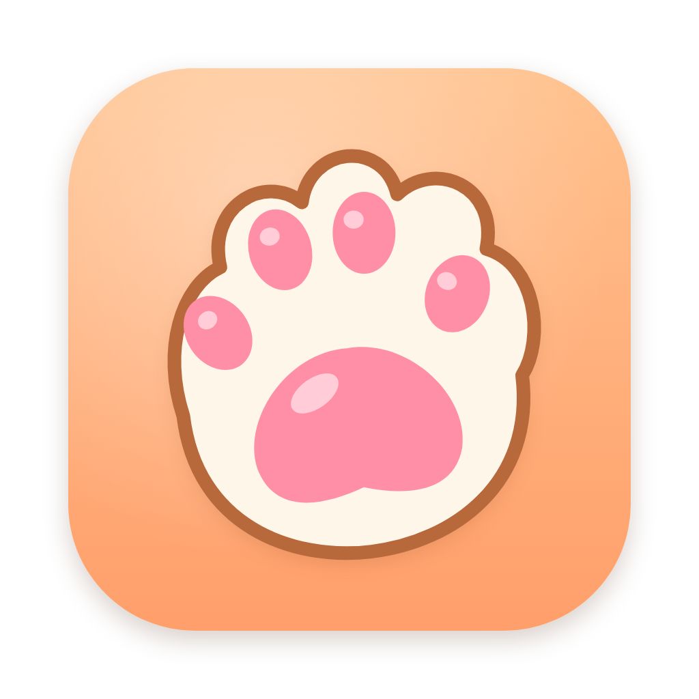
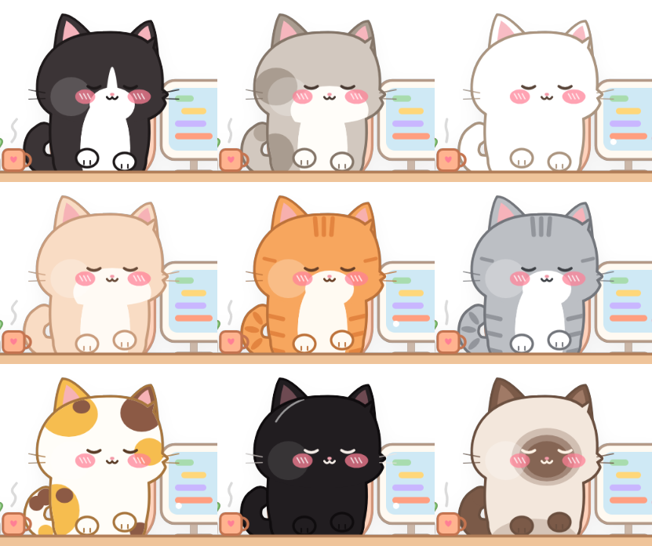

<h1>BoneUp 喵 🐾</h1>
<strong>九只小猫，陪你上班，也提醒你站起来。</strong>

1.3 特别版 · macOS 12+ · Apple 芯片 / Intel 通用

<a href="MEOW.md">English</a> | <strong>简体中文</strong>

BoneUp 喵是 BoneUp 的 Q 版猫咪特别版。坐太久，小猫逐渐变灰、塌下去，最后变成白白的骨头猫；站起来活动后点 **STAND UP**，帮助它恢复。

## 下载

[**下载 BoneUp 喵 1.3 Mac 版**](https://github.com/chartercharon26/BoneUp/releases/download/v1.3.0-meow/BoneUp-Meow-1.3-macOS.zip) · [发布说明](https://github.com/chartercharon26/BoneUp/releases/tag/v1.3.0-meow)

特别版目前**仅有 Mac 版**。原版 BoneUp 的 Mac／Windows 下载见[仓库首页](README.zh-CN.md#下载)。

## 特别版内容

- 9 只 Q 版小猫，各有外观和专属互动。
- 猫咪录音、音量控制和专注模式。
- 久坐变骨头猫、STAND UP 恢复及 WALK 倒计时。
- 上班、午饭、午休、下班场景，可调整作息和任务模式。
- 菜单和气泡支持简体中文／English。
- 程序、设置、开机启动项独立于原版 BoneUp。

## 安装与切换语言

1. 完整解压 ZIP，打开 `BoneUp-Meow-1.3.dmg`。
2. 把 **BoneUp 喵** 拖入旁边的“应用程序”。
3. 从“应用程序”打开，菜单栏出现 **🐾**。
4. **🐾 → 语言 / Language** 可切换简体中文或 English。

首次启动会启用开机自动启动，并创建桌面／程序坞快捷方式，可在菜单中调整。程序采用本机签署，未经过 Apple 公证；如被 macOS 拦截，请在“系统设置 → 隐私与安全性”中检查。

## 九只猫与小动作

| 猫咪 | 点击后的专属动作 |
| --- | --- |
| 奶牛猫 | 挠屏幕，留下粉色爪印。 |
| 灰白猫 | 唱小曲，头顶飘出音符。 |
| 小白猫 | 害羞脸红，冒出爱心。 |
| 奶油猫 | 缩成面包，打盹呼噜。 |
| 橘猫（默认） | 把桌上的杯子推下去。 |
| 灰狸花 | 伸大懒腰、打哈欠。 |
| 三花猫 | 扑毛线球，忘记工作。 |
| 小黑猫 | 关灯，带来一个小惊吓。 |
| 暹罗猫 | 超大声喵叫。 |

切换：**🐾 → 悬浮小猫 → 换皮肤**。点 SIT 后的时间调整 1–60 分钟的久坐间隔；喇叭按钮调音量和专注模式。作息与任务模式仍在菜单中。

## 图文使用说明

下载包包含中英文图文说明、快速开始与使用条款，也可单独下载：

- [简体中文图文手册（PDF）](https://github.com/chartercharon26/BoneUp/releases/download/v1.3.0-meow/BoneUp-Meow-1.3-User-Guide-zh-CN.pdf)
- [English illustrated guide（HTML，下载后用浏览器打开）](https://github.com/chartercharon26/BoneUp/releases/download/v1.3.0-meow/BoneUp-Meow-1.3-User-Guide-English.html)

## 使用与反馈

[中文使用条款](MEOW-TERMS.zh-CN.txt)／[English terms](MEOW-TERMS.txt)，保留所有权利。本仓库提供安装包和说明，不授予开源许可。GitHub 自动生成的 **Source code** ZIP／TAR 不是程序安装包。

欢迎[用中文或英文提交问题](https://github.com/chartercharon26/BoneUp/issues)，请注明 **BoneUp 喵 1.3**、macOS 版本和实际情况。
