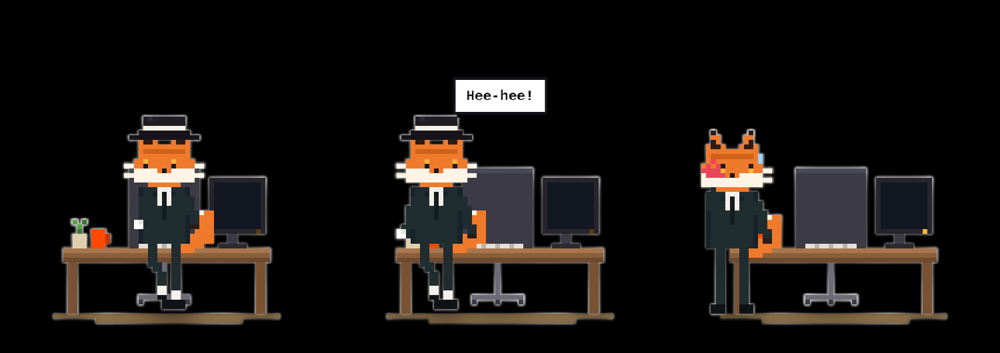

  
  <h1>BoneUp 🦴</h1>
  
<strong>A desktop pet that reminds you to stand up.</strong>

  
macOS & Windows · English & 简体中文 · Version 1.1

  
<strong>English</strong> | <a href="ORIGINAL.zh-CN.md">简体中文</a>

  
<a href="https://github.com/chartercharon26/BoneUp/releases/tag/v1.1.0"><strong>Download BoneUp →</strong></a>

---

Meet your tiny desk companion. Keep sitting and your pet gradually turns into a skeleton. Stand up, take a break, and let it recover.

## Download

| Platform | Download | Getting started |
| --- | --- | --- |
| macOS | [BoneUp 1.1 for macOS](https://github.com/chartercharon26/BoneUp/releases/download/v1.1.0/BoneUp-1.1-macOS.zip) | Extract the ZIP, open the DMG, then drag BoneUp into Applications. |
| Windows | [BoneUp 1.1 for Windows](https://github.com/chartercharon26/BoneUp/releases/download/v1.1.0/BoneUp-1.1-Windows.zip) | Extract **all** files, then double-click `install.bat`. |

Both packages include English and Chinese user guides, quick-start instructions, and terms of use. Choose one of the two platform packages above; GitHub's automatically generated **Source code** archives are not installers.

## Fourteen pixel desk companions

## All fourteen click reactions

Click a character **while it is working or working late**. These are real frames from original 1.1. Cracks, scratches and shakes stay inside the pet window and fade away.

<table>
<tr>
<td width="50%" valign="top">
<strong>Mr. Maine Coon</strong>

Hisses angrily and slashes four blood-red scratches.
</td>
<td width="50%" valign="top">
<strong>Miss Golden Shorthair</strong>

Lets out a meow and leaves white scratches across the pet window.
</td>
</tr>
<tr>
<td width="50%" valign="top">
<strong>Mr. Panda</strong>

Crunches through a bamboo stalk, then burps.
</td>
<td width="50%" valign="top">
<strong>Miss Giraffe</strong>

Stretches her neck until her head is out of the frame.
</td>
</tr>
<tr>
<td width="50%" valign="top">
<strong>Mr. Croc</strong>

In 1.1, clicking only triggers its voice; there is no unique animation yet. The image shows its normal appearance.
</td>
<td width="50%" valign="top">
<strong>Mr. Husky</strong>

Blushes over flowers, walks off to give them, gets slapped off-screen and returns holding his cheek.
</td>
</tr>
<tr>
<td width="50%" valign="top">
<strong>Ms. Golden Retriever</strong>

The husky visits with flowers and she slaps him away.
</td>
<td width="50%" valign="top">
<strong>Wolf King</strong>

Howls at the sky as sound waves rise from his head.
</td>
</tr>
<tr>
<td width="50%" valign="top">
<strong>Mr. Lion</strong>

Lets out a huge, open-jawed roar that shakes the pet window.
</td>
<td width="50%" valign="top">
<strong>Miss Tiger</strong>

Roars with bared fangs and an angry brow.
</td>
</tr>
<tr>
<td width="50%" valign="top">
<strong>Ms. Rabbit</strong>

Mr. Fox moonwalks in to flirt, and she slaps him away.
</td>
<td width="50%" valign="top">
<strong>Mr. Fox</strong>

Dances in a top hat and white gloves, moonwalks out, then returns with a red handprint after an off-screen slap.
</td>
</tr>
<tr>
<td width="50%" valign="top">
<strong>Mr. Elephant</strong>

Raises his trunk and trumpets; a shockwave cracks the glass.
</td>
<td width="50%" valign="top">
<strong>Mr. Shark</strong>

Snaps rows of teeth at the screen and leaves cracks in the glass.
</td>
</tr>
</table>

Another click will not interrupt a routine; wait until it ends. Adjust the sound with the speaker at the bottom left.

### Mr. Fox’s little drama: dance → moonwalk → slap

## What it does

- **A pet that changes with your sitting time.** A visible nudge to get up and move.
- **14 animal skins.** Cats, a panda, a giraffe, a husky, and more.
- **Workday reminders.** Breaks, lunch, naps, wake-up time, and overtime.
- **Task mode.** Start a focused session with your own reminder interval.
- **A quieter desktop.** Focus mode and adjustable volume.
- **English and Simplified Chinese.** Follow your system language or choose one manually.

## First launch

**macOS:** Open BoneUp from Applications. Look for its menu-bar icon and the pet on your desktop. The build targets macOS 12 or later and includes Apple silicon and Intel support.

**Windows:** Keep the extracted `assets` and `data` folders next to `install.bat` while installing. The installer builds and installs the app using the Windows .NET Framework compiler. If it reports a missing .NET Framework, follow the message to install Microsoft's .NET Framework 4.8, then try again.

The app is configured to start when you sign in. You can change this from its menu. A sleeping or powered-off computer cannot reliably play a scheduled reminder.

### Change the language

Open the **menu-bar menu** on macOS or the **system-tray menu** on Windows, then choose **语言 / Language → English** or **简体中文**. **Follow system** selects the language automatically.

## Guides

- [English user guide](User-Guide-English.pdf)
- [简体中文使用手册](User-Guide-zh-CN.pdf)

## Feedback

Please [open an issue](https://github.com/chartercharon26/BoneUp/issues) in **English or Chinese**. Include your operating system, BoneUp version, what you expected, and what happened. Remove personal information from screenshots and logs before sharing them.

## Use and redistribution

BoneUp is distributed for personal use under the included [English terms](TERMS-OF-USE.txt) / [中文使用条款](TERMS-OF-USE.zh-CN.txt). All rights reserved. This repository provides downloads and documentation; it does not grant an open-source license. Redistribution, modification, and commercial use require the author's written permission under those terms.

[← Back to edition chooser](README.md)
