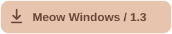
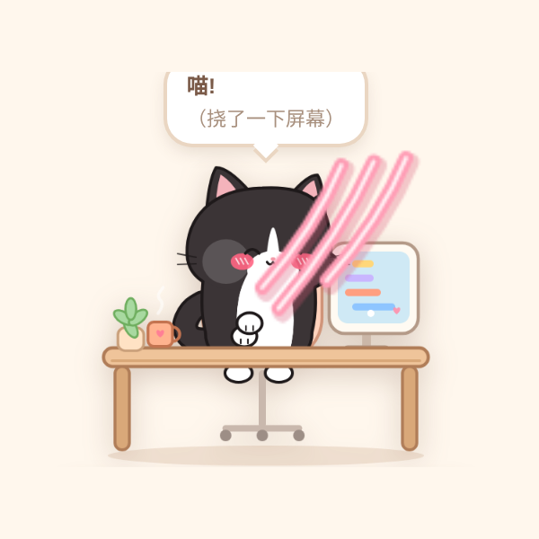
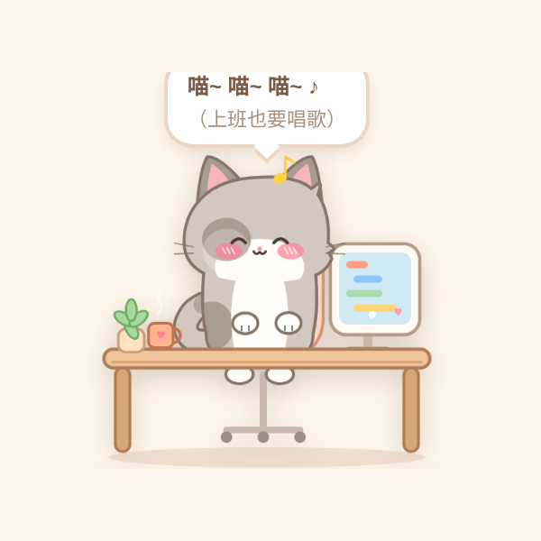
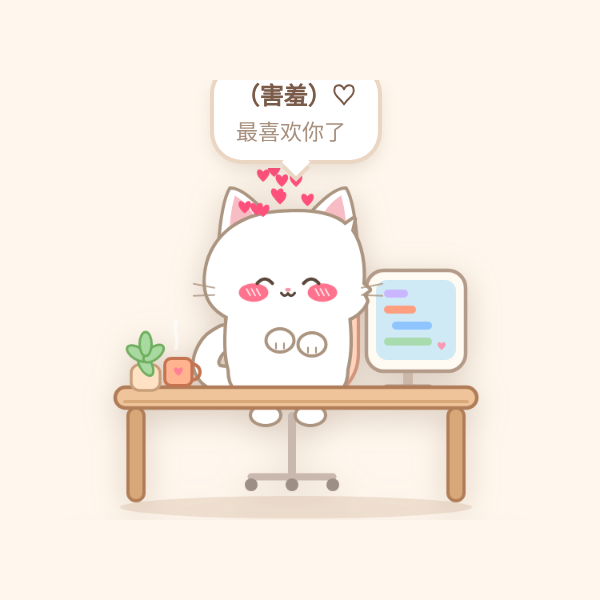
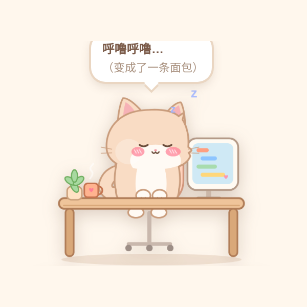
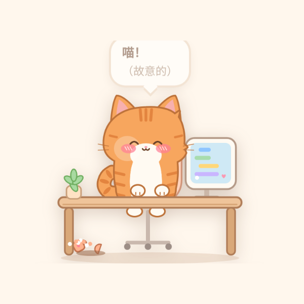
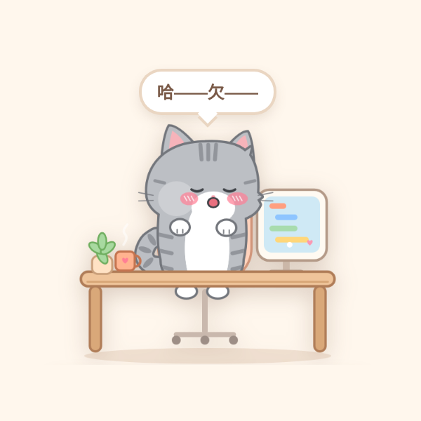
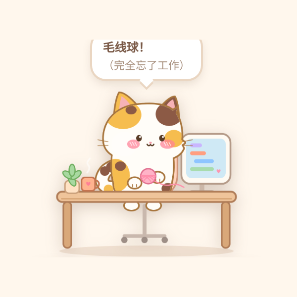
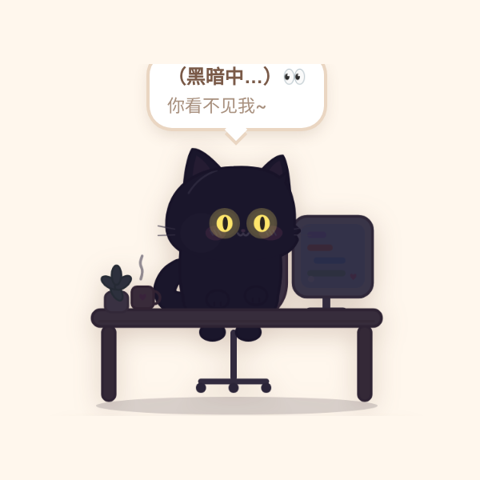
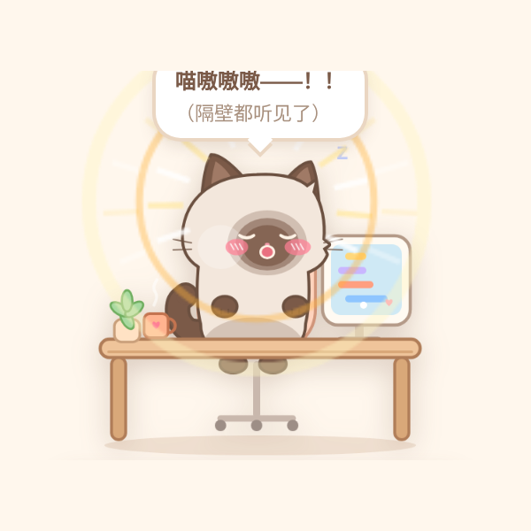

<strong>English</strong> · <a href="README.zh-CN.md">简体中文</a>

<h1 align="center">A little company. A gentle nudge to move.</h1>

Pixel animals or soft chibi cats? Choose your corner-of-the-screen companion.

   

Original + Meow: macOS / Windows · Both speak English & 简体中文

## Sit too long. Your pet shows it.

Keep sitting and the bones creep up from the feet. Get up, take a break, then click **STAND UP** to help your companion recover. A small, visible reminder in the corner of your desktop.

## Pick your desk companion

### 🦴 Original BoneUp 1.1 · A pixel menagerie

**14 animals** with distinct voices, skeletons and click reactions. Cats, a panda, a giraffe, a husky, a lion, a shark… pick your personality.

#### Click a character. See what happens.

Click a character **while it is working or working late**. These are real frames from original 1.1. Cracks, scratches and shakes stay inside the pet window and fade away.

<table>
<tr>
<td width="50%" valign="top">
<strong>Mr. Maine Coon</strong>

Hisses angrily and slashes four blood-red scratches.
</td>
<td width="50%" valign="top">
<strong>Miss Golden Shorthair</strong>

Lets out a meow and leaves white scratches across the pet window.
</td>
</tr>
<tr>
<td width="50%" valign="top">
<strong>Mr. Panda</strong>

Crunches through a bamboo stalk, then burps.
</td>
<td width="50%" valign="top">
<strong>Miss Giraffe</strong>

Stretches her neck until her head is out of the frame.
</td>
</tr>
<tr>
<td width="50%" valign="top">
<strong>Mr. Croc</strong>

In 1.1, clicking only triggers its voice; there is no unique animation yet. The image shows its normal appearance.
</td>
<td width="50%" valign="top">
<strong>Mr. Husky</strong>

Blushes over flowers, walks off to give them, gets slapped off-screen and returns holding his cheek.
</td>
</tr>
<tr>
<td width="50%" valign="top">
<strong>Ms. Golden Retriever</strong>

The husky visits with flowers and she slaps him away.
</td>
<td width="50%" valign="top">
<strong>Wolf King</strong>

Howls at the sky as sound waves rise from his head.
</td>
</tr>
<tr>
<td width="50%" valign="top">
<strong>Mr. Lion</strong>

Lets out a huge, open-jawed roar that shakes the pet window.
</td>
<td width="50%" valign="top">
<strong>Miss Tiger</strong>

Roars with bared fangs and an angry brow.
</td>
</tr>
<tr>
<td width="50%" valign="top">
<strong>Ms. Rabbit</strong>

Mr. Fox moonwalks in to flirt, and she slaps him away.
</td>
<td width="50%" valign="top">
<strong>Mr. Fox</strong>

Dances in a top hat and white gloves, moonwalks out, then returns with a red handprint after an off-screen slap.
</td>
</tr>
<tr>
<td width="50%" valign="top">
<strong>Mr. Elephant</strong>

Raises his trunk and trumpets; a shockwave cracks the glass.
</td>
<td width="50%" valign="top">
<strong>Mr. Shark</strong>

Snaps rows of teeth at the screen and leaves cracks in the glass.
</td>
</tr>
</table>

Another click will not interrupt a routine; wait until it ends. Adjust the sound with the speaker at the bottom left.

[Download for macOS](https://github.com/chartercharon26/BoneUp/releases/download/v1.1.0/BoneUp-1.1-macOS.zip) · [Download for Windows](https://github.com/chartercharon26/BoneUp/releases/download/v1.1.0/BoneUp-1.1-Windows.zip) · [Explore the original edition](ORIGINAL.md)

### 🐾 BoneUp Meow 1.3 · Soft cats, big personalities

**9 chibi cats** that scratch, sing, loaf, push cups and turn out the lights. Available for macOS and Windows, installed separately from original BoneUp.

#### Click a cat. Nine little personalities.

Click while your cat is **at its desk, working or working late, before it becomes a bone cat**. Another click will not interrupt a routine. In the bone state, clicking only makes its jaw chatter. These real 1.3 guide screenshots have Chinese speech bubbles; the English captions explain every reaction.

<table>
<tr>
<td width="50%" valign="top">
<strong>Tuxedo</strong>

Growls and swipes a paw across the screen, leaving three pink claw marks.
</td>
<td width="50%" valign="top">
<strong>Grey & White</strong>

Sings a little tune in its own meows, with musical notes floating overhead.
</td>
</tr>
<tr>
<td width="50%" valign="top">
<strong>Snow White</strong>

Blushes, sends up little hearts and shyly says it loves you.
</td>
<td width="50%" valign="top">
<strong>Cream</strong>

Tucks into a loaf, takes a purring nap, then wakes up.
</td>
</tr>
<tr>
<td width="50%" valign="top">
<strong>Ginger (default)</strong>

Stares at you, deliberately pushes the mug off the desk, then gives a cheeky meow after it breaks.
</td>
<td width="50%" valign="top">
<strong>Grey Tabby</strong>

Raises both paws for a big stretch, then lets out a long yawn.
</td>
</tr>
<tr>
<td width="50%" valign="top">
<strong>Calico</strong>

Bats a yarn ball from side to side, purring and forgetting all about work.
</td>
<td width="50%" valign="top">
<strong>Black Cat</strong>

Turns off the lights for spooky sounds and glowing eyes, gives a sudden hiss, then switches the lights back on and purrs.
</td>
</tr>
<tr>
<td colspan="2" align="center">
<strong>Siamese</strong>

Lets out a loud yowl, with sound waves and a shaking scene.
</td>
</tr>
</table>

[Download for macOS](https://github.com/chartercharon26/BoneUp/releases/download/v1.3.0-meow/BoneUp-Meow-1.3-macOS.zip) · [Download for Windows](https://github.com/chartercharon26/BoneUp/releases/download/v1.3.0-meow/BoneUp-Meow-1.3-Windows.zip) · [Explore the Meow special edition](MEOW.md)

## Work, break, repeat

| Sitting reminders | Your working day | Your own rhythm |
| --- | --- | --- |
| Adjustable intervals and STAND UP recovery | Lunch, naps, wake-up, clock-out and overtime | Task Mode, Focus mode and volume controls |

## Download

| Edition | Platform | Getting started |
| --- | --- | --- |
| [Original BoneUp 1.1](https://github.com/chartercharon26/BoneUp/releases/tag/v1.1.0) | macOS / Windows | Mac: extract, open the DMG, drag into Applications. Windows: extract all files and run `install.bat`. |
| [BoneUp Meow 1.3](https://github.com/chartercharon26/BoneUp/releases/tag/v1.3.0-meow) | macOS 12+ · Apple silicon / Intel; Windows 10 / 11 | Mac: extract, open the DMG and drag **BoneUp 喵** into Applications. Windows: extract all files, then run `install.bat`. |

Both editions support **English / 简体中文** and include bilingual instructions. The Meow Windows package includes a Chinese illustrated guide and an English / Chinese quick start. Choose **语言 / Language** from the app menu. GitHub's automatic **Source code** archives are not installers.

## Guides and feedback

- Original: [English visual introduction](ORIGINAL.md) · [中文](ORIGINAL.zh-CN.md) · [English guide](User-Guide-English.pdf) · [中文手册](User-Guide-zh-CN.pdf)
- Meow: [English visual introduction](MEOW.md) · [中文](MEOW.zh-CN.md)
- [Send feedback in English or Chinese](https://github.com/chartercharon26/BoneUp/issues). Include the edition, OS and what happened.

Terms and redistribution

Personal use; all rights reserved. Original terms: [English](TERMS-OF-USE.txt) / [中文](TERMS-OF-USE.zh-CN.txt). Meow terms: [English](MEOW-TERMS.txt) / [中文](MEOW-TERMS.zh-CN.txt). Public downloads do not grant an open-source licence; redistribution, modification and commercial use require the author's permission under the terms.

