
<a href="README.md">English</a> · <strong>简体中文</strong>

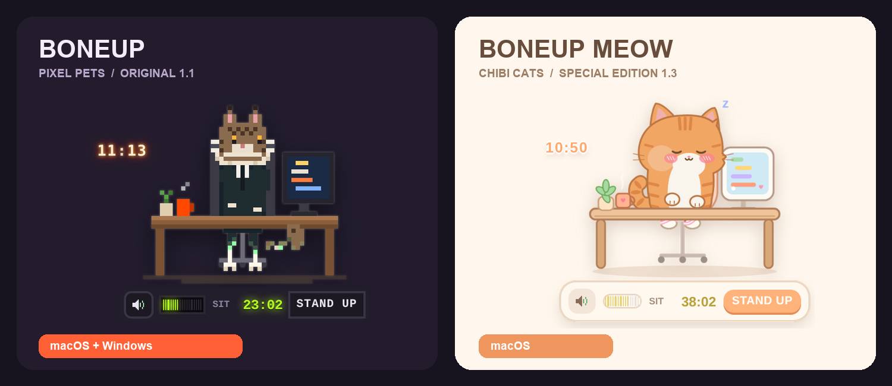

<h1 align="center">工作有人陪，久坐有人催。</h1>

像素小动物，还是软萌小猫？选一个，放在你的桌面角落。

  

原版：Mac / Windows · 喵特别版：Mac · 两版均支持中文 / English

## 坐太久，它真的会变骨头

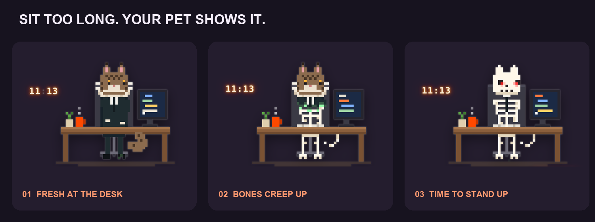

连续坐着，小动物会从脚开始慢慢变成骨头；站起来活动后，点 **STAND UP** 帮它恢复。提醒就在桌面角落，陪你把“该起来了”变成一件看得见的小事。

## 选一位桌面伙伴

### 🦴 原版 BoneUp 1.1 · 像素动物园

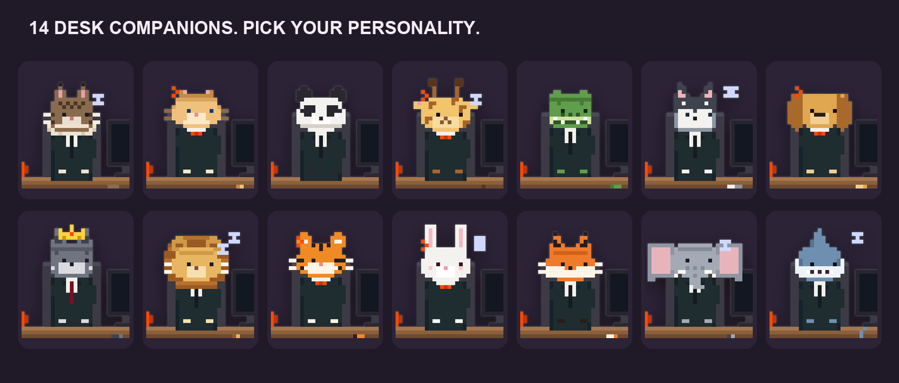

**14 种动物**，各有叫声与骷髅形态，点击还能看到不同反应。猫咪、熊猫、长颈鹿、哈士奇、狮子、鲨鱼……选择你喜欢的那个。

#### 点一下，每位角色都有自己的反应

在**工作或加班状态**点击角色即可触发。以下图片来自原版 1.1 的实际画面；动作中的裂纹、抓痕和震动只出现在宠物窗口内，会自行消失。

<table>
<tr>
<td width="50%" valign="top">
<strong>缅因先生</strong>
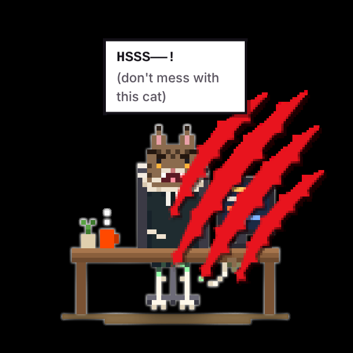
生气地哈气，挥出四道血红色抓痕。
</td>
<td width="50%" valign="top">
<strong>金渐层小姐</strong>
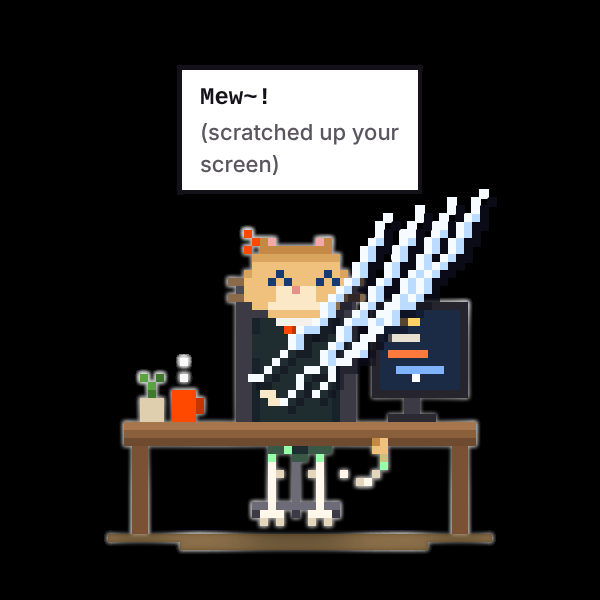
喵一声，在宠物窗口上留下白色抓痕。
</td>
</tr>
<tr>
<td width="50%" valign="top">
<strong>熊猫先生</strong>
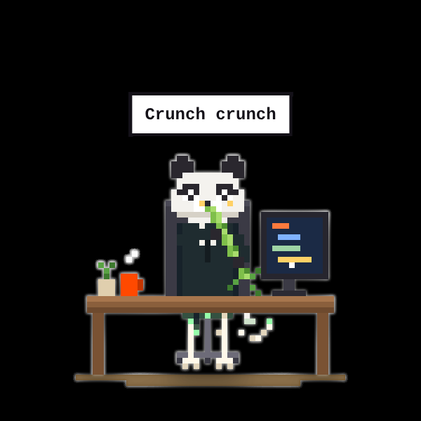
咔嚓咔嚓啃完一根竹子，最后打个嗝。
</td>
<td width="50%" valign="top">
<strong>长颈鹿小姐</strong>
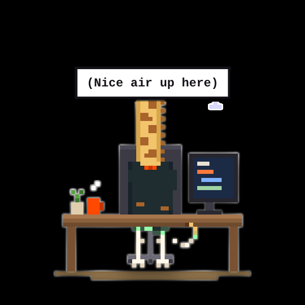
脖子越伸越长，一直伸出画面。
</td>
</tr>
<tr>
<td width="50%" valign="top">
<strong>鳄鱼先生</strong>
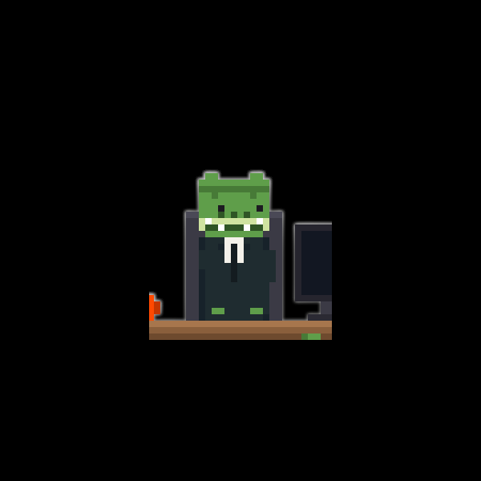
1.1 中点击后只会发出叫声，暂无专属动画；图中为平时的外观。
</td>
<td width="50%" valign="top">
<strong>哈士奇先生</strong>
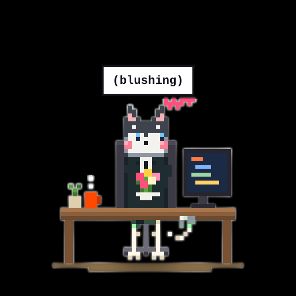
捧花脸红，走出画面送花；画外挨了一巴掌，捂着脸回来。
</td>
</tr>
<tr>
<td width="50%" valign="top">
<strong>金毛女士</strong>
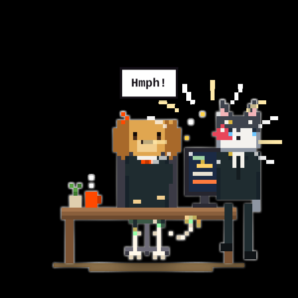
哈士奇带着花过来，被她一巴掌打走。
</td>
<td width="50%" valign="top">
<strong>狼王</strong>
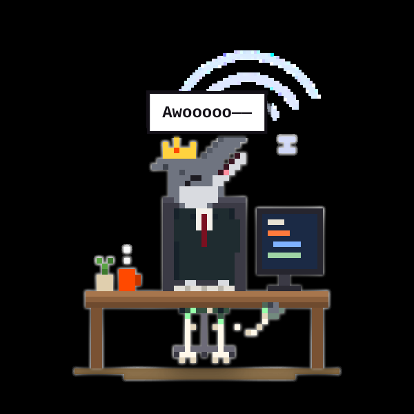
仰头长嚎，声波从头顶一圈圈冒出。
</td>
</tr>
<tr>
<td width="50%" valign="top">
<strong>狮子先生</strong>
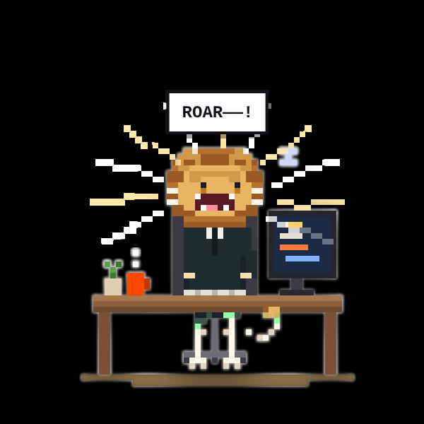
张大嘴怒吼，声浪震动宠物窗口。
</td>
<td width="50%" valign="top">
<strong>老虎小姐</strong>
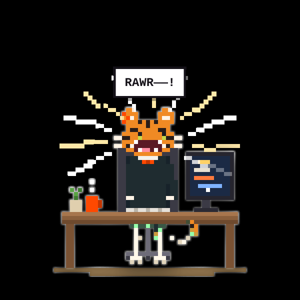
皱眉露出獠牙，发出一声怒吼。
</td>
</tr>
<tr>
<td width="50%" valign="top">
<strong>兔子女士</strong>
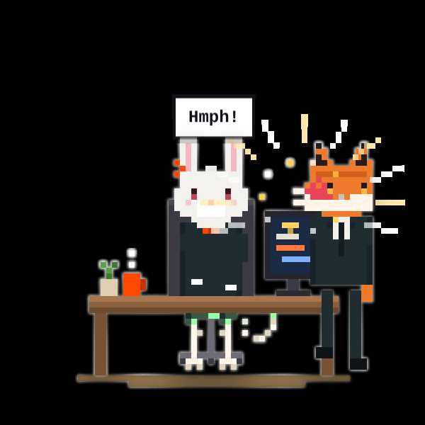
狐狸滑着太空步来搭讪，被她一巴掌打走。
</td>
<td width="50%" valign="top">
<strong>狐狸先生</strong>
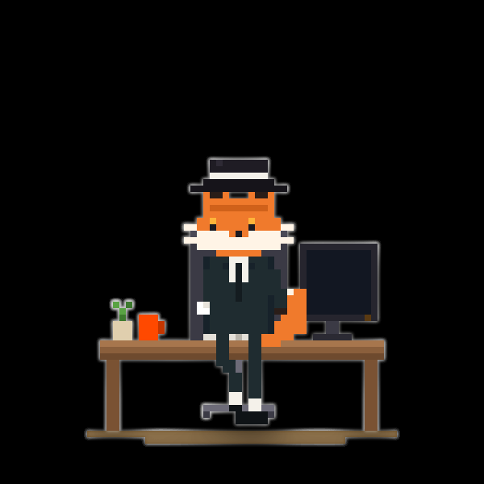
戴礼帽和白手套跳舞，太空步滑出画面；画外一声巴掌响，带着红手印回来。
</td>
</tr>
<tr>
<td width="50%" valign="top">
<strong>大象先生</strong>
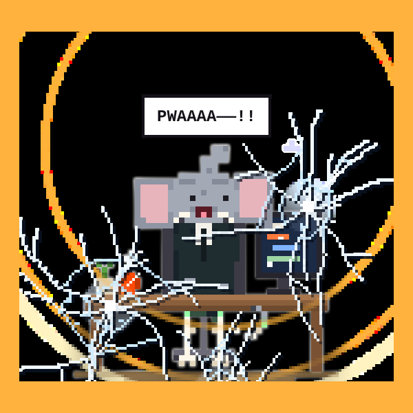
举起鼻子鸣叫，冲击波震出玻璃裂纹。
</td>
<td width="50%" valign="top">
<strong>鲨鱼先生</strong>
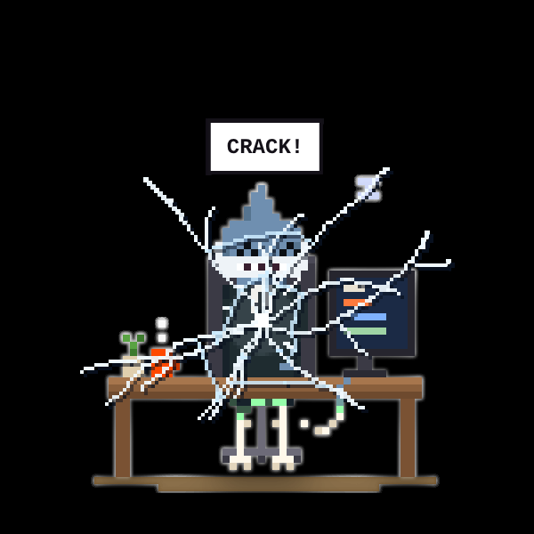
上下排尖牙咬向屏幕，留下玻璃裂纹。
</td>
</tr>
</table>

动作播放中再次点击不会打断它，等表演结束后再点。声音大小可用左下角的扬声器调节。

[Mac 下载](https://github.com/chartercharon26/BoneUp/releases/download/v1.1.0/BoneUp-1.1-macOS.zip) · [Windows 下载](https://github.com/chartercharon26/BoneUp/releases/download/v1.1.0/BoneUp-1.1-Windows.zip) · [查看原版图文介绍](ORIGINAL.zh-CN.md)

### 🐾 BoneUp 喵 1.3 · 软萌猫咪特别版

**9 只 Q 版小猫**，挠屏幕、推杯子、变面包、关灯吓人。独立安装，可与原版共存。

[Mac 下载](https://github.com/chartercharon26/BoneUp/releases/download/v1.3.0-meow/BoneUp-Meow-1.3-macOS.zip) · [查看特别版图文介绍](MEOW.zh-CN.md)

## 陪你工作，也陪你休息

| 久坐提醒 | 日常作息 | 自由安排 |
| --- | --- | --- |
| 可调间隔、STAND UP 恢复 | 午饭、午休、起床、下班、加班 | 任务模式、专注与音量控制 |

## 下载

| 版本 | 系统 | 安装方法 |
| --- | --- | --- |
| [原版 BoneUp 1.1](https://github.com/chartercharon26/BoneUp/releases/tag/v1.1.0) | macOS / Windows | Mac：解压后打开 DMG，拖入应用程序。Windows：全部解压后运行 `install.bat`。 |
| [BoneUp 喵 1.3 特别版](https://github.com/chartercharon26/BoneUp/releases/tag/v1.3.0-meow) | macOS 12+ · Apple 芯片 / Intel | 解压后打开 DMG，把 **BoneUp 喵**拖入应用程序。 |

两个版本均支持**中文 / English**，安装包附有中英文指南。语言切换在菜单中的 **语言 / Language**。自动生成的 **Source code** 不是安装包。

## 使用说明与反馈

- 原版：[中文图文介绍](ORIGINAL.zh-CN.md) · [English](ORIGINAL.md) · [中文手册](User-Guide-zh-CN.pdf) · [English guide](User-Guide-English.pdf)
- 喵特别版：[中文图文介绍](MEOW.zh-CN.md) · [English](MEOW.md)
- [用中文或英文反馈问题](https://github.com/chartercharon26/BoneUp/issues)：请注明版本、系统和遇到的情况。

使用条款与分发

供个人使用，保留所有权利。原版条款：[中文](TERMS-OF-USE.zh-CN.txt)／[English](TERMS-OF-USE.txt)；特别版：[中文](MEOW-TERMS.zh-CN.txt)／[English](MEOW-TERMS.txt)。公开下载不代表授予开源许可，再分发、修改及商业使用须按条款获得作者许可。

